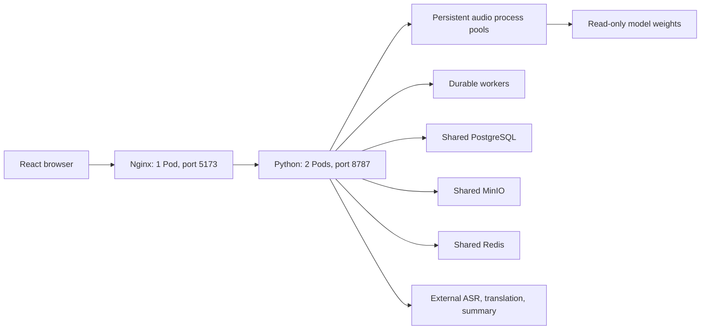

# Web and Python architecture

[繁體中文](../reference/ARCHITECTURE.zh-TW.md) | English

The browser runs React. Vite serves development builds; production builds are static assets served by Nginx. Both proxy `/api` to Python, keeping browser requests on the frontend origin.

Each backend Pod runs configurable Uvicorn worker processes for asynchronous I/O. Each worker owns model HTTP connections, persistent native-audio subprocess pools and a durable background worker. The base defaults to two Uvicorn workers per Pod; the validated capacity profile uses four. One supervised metrics-exporter process per Pod publishes snapshots outside the API workers. The active deployment runs the `all` role on both Pods. Separate `api`, `audio-service`, and `audio-worker` roles are optional deployment alternatives.

Shared PostgreSQL, MinIO, Redis, and an identical authentication secret let requests move between backend Pods without sticky sessions. Immutable recording chunks, compare-and-swap settings, account fencing, job lease generations, and shared token revocation coordinate concurrent activity.

Frontend code belongs in `frontend/src/`, with contracts and validators in `frontend/shared/`. Backend code belongs in `backend/app/`; default prompts and templates belong in `backend/resources/`. Private runtime data belongs in `data/`, while model weights and native binaries belong in `models/`.

External services provide ASR, translation, and summaries. Local audio processing uses FFmpeg, Silero, Sherpa, and optionally Nemotron. API credentials stay on the backend. Metrics are exposed directly by each Python Pod at `/metrics`.

See [deployment](DEPLOYMENT.md) for operational steps and [validation](VALIDATION.md) for what has actually been tested.

Normal capture uses 3000ms/250ms. Display merging permits compatible punctuated fragments below 40 characters to continue; explicit boundaries, speaker/language rules, frozen groups and ten-second/70-character guards remain. See [caption speed](CAPTION_SPEED.md). Raw experiments are local-only; [curated results](../reports/README.md) and [reproduction](REPRODUCE.md) are versioned.
