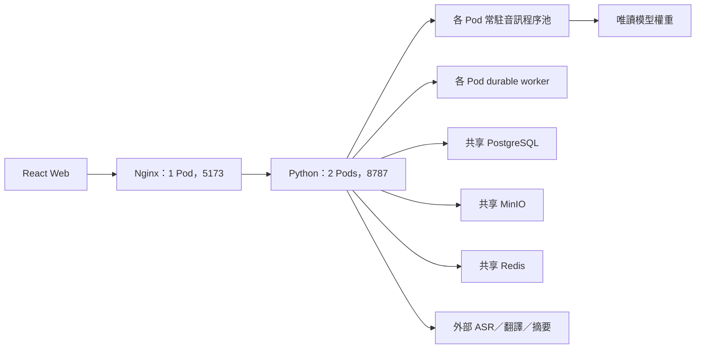

# 現行 Web／Python 架構

繁體中文 | [English](../en/ARCHITECTURE.md)

更新日期：2026-10-24。產品程式僅保留 React Web 前端與 Python 後端；Node 用於前端建置及測試。

port 由兩端各自環境變數載入。開發使用 Vite 代理；正式前端由 Nginx 提供靜態檔與 `/api` 串流代理。

| 目錄 | 責任 |
| --- | --- |
| `frontend/src/` | UI、麥克風、錄音緩衝、字幕呈現及瀏覽器量測 |
| `frontend/shared/` | 前端型別契約與驗證器 |
| `backend/app/` | Python API、認證、儲存、音訊、背景工作、metrics |
| `backend/resources/` | 版本管理的內建範本與提示詞 |
| `data/` | 私有本機資料與錄音，禁止放入映像 |
| `models/` | 唯讀模型權重與原生 runtime |
| `deploy/` | Docker、Compose、K8s、監控 |

每個後端以單一 Uvicorn 程序處理非同步 I/O，音訊計算交給常駐子程序池。跨 Pod 狀態透過共享儲存與 Redis 協調；immutable chunks、設定 CAS、帳號 fencing、工作 lease generation 與 JWT 撤銷避免依賴程序內 session。

ASR／翻譯／摘要可連外部服務；Silero、Sherpa、FFmpeg／Nemotron 的本機流程需準備權重與 runtime。角色分層及 HPA 範例不屬於目前固定 1 前端＋2 完整後端部署。

操作見 [Web 分離指南](../guide/WEB_SPLIT.zh-TW.md)，驗證證據見 [部署報告](../reports/WEB_PYTHON_K8S_2026-10-24.zh-TW.md)。舊報告與流程圖保留設計歷史，不代表目前 runtime。
