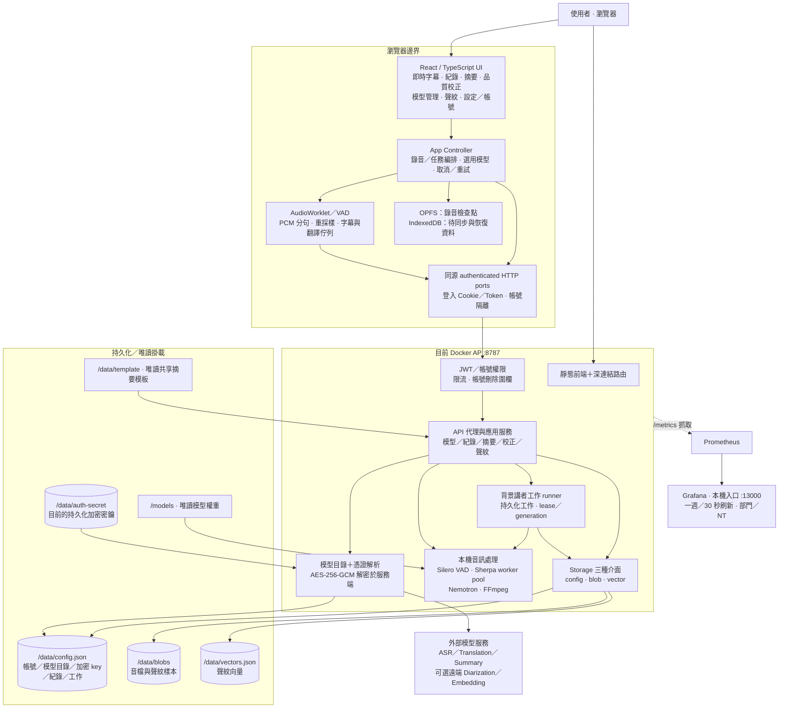
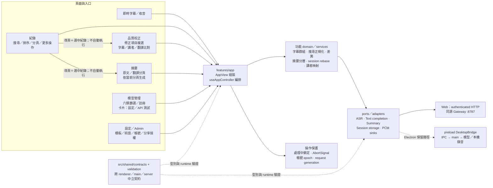
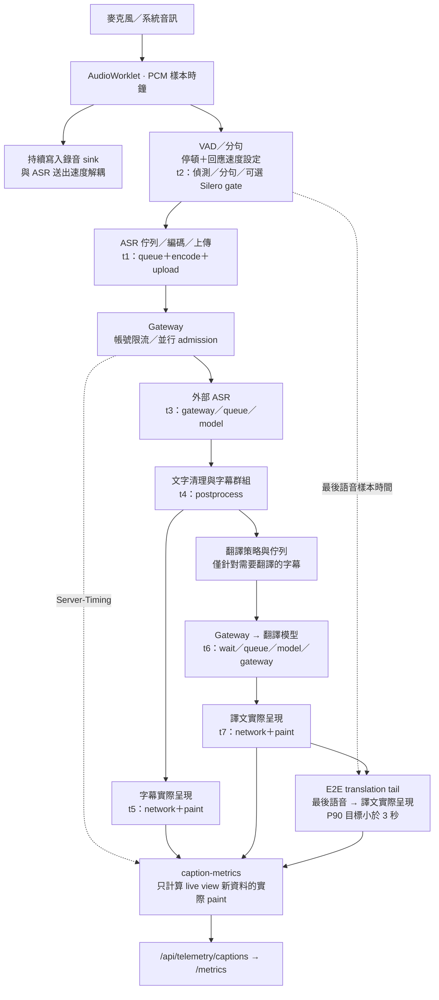
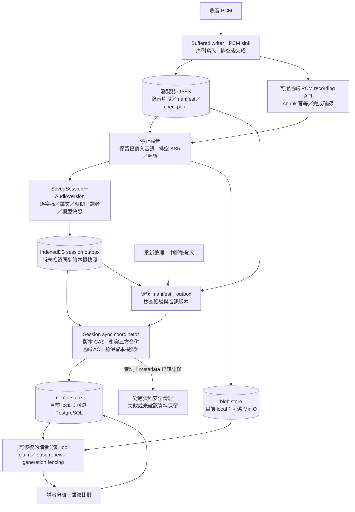
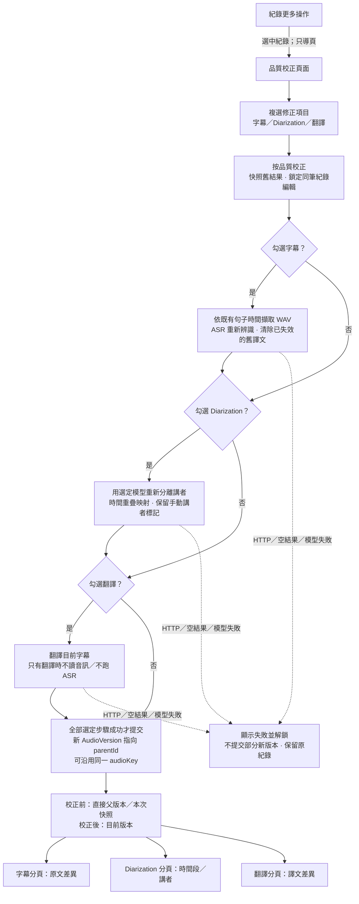
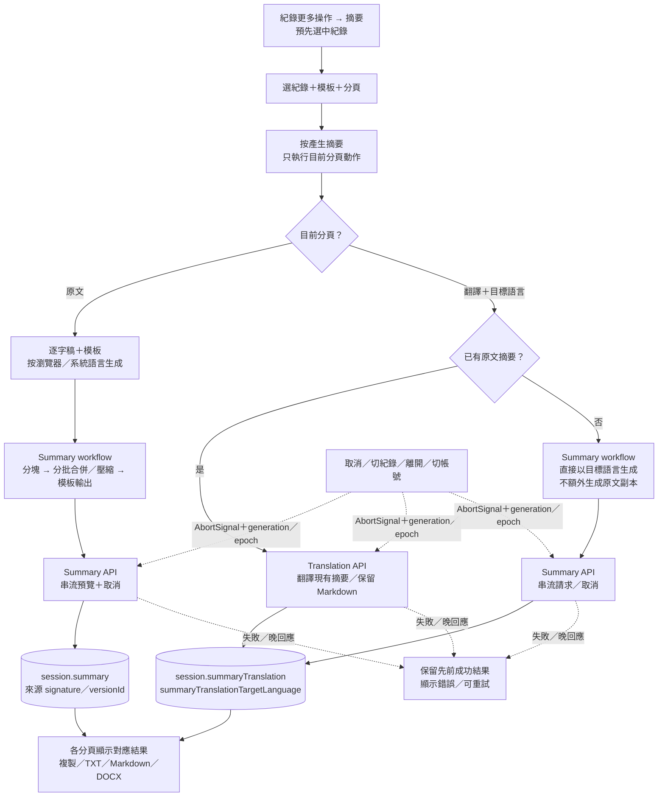
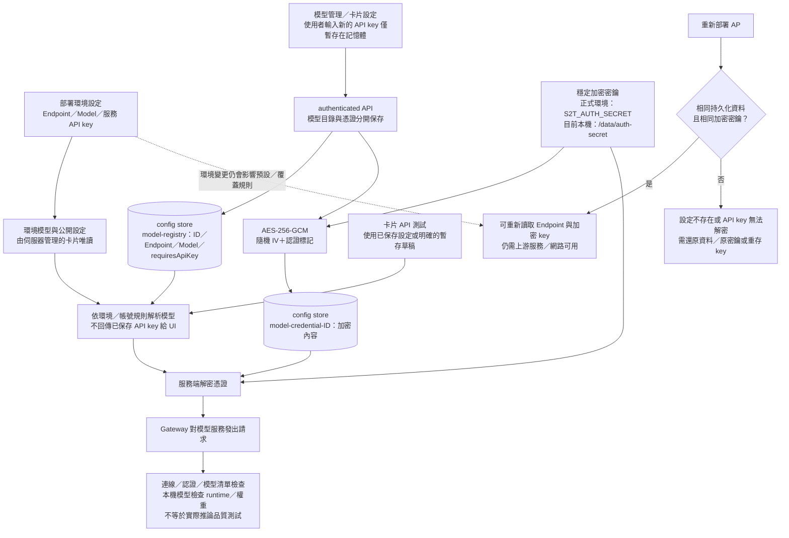
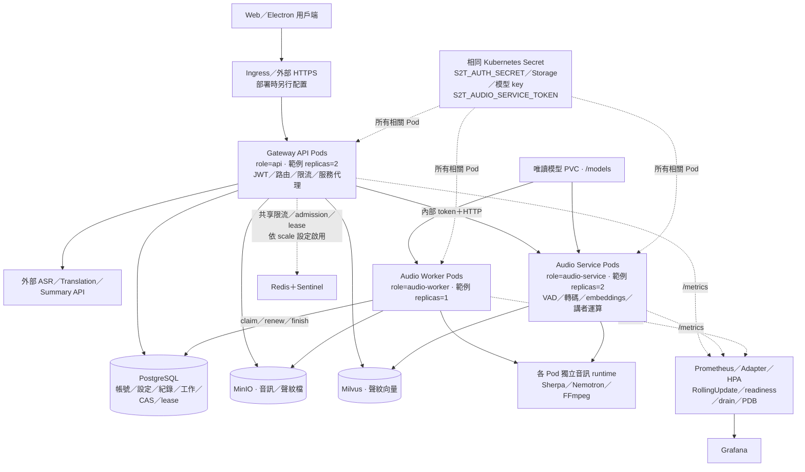
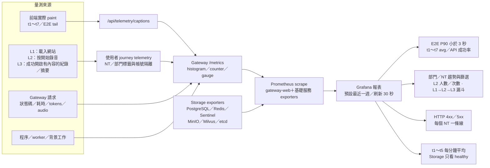

# 系統架構與程式責任

狀態：現行程式架構＋有標註的可選部署。更新日期：2026-10-18。

本文件以 repository 實作為架構來源；「目前本機」另以執行中容器的唯讀檢查核對。沒有將範例 K8s、遠端 Storage 或 GPU 畫成已在本機啟用。

## 部署現況與邊界

| 項目 | 目前本機 AP | 可選部署／限制 |
| --- | --- | --- |
| 對外入口 | Docker AP `8787`，role=`all` | K8s 可拆 API／Audio Service／Audio Worker |
| config／blob／vector | 全部為 local adapters，掛在 `/data` 持久化 Volume | 可各自切換 PostgreSQL／MinIO／Milvus；不是自動故障時切成本機 |
| 音訊服務 | AP 內本機 runtime，未設定獨立 Audio Service | 可透過 private token HTTP 移到 Audio Service |
| 模型權重 | `/models` 唯讀掛載 | K8s 使用唯讀模型 PVC；可另選 CPU／CUDA，未在本圖聲稱 GPU 已驗收 |
| 模板 | `/data/template` 唯讀共享模板，個人模板另存 config | 共享檔案與帳號個人副本分開 |
| 加密密鑰 | 未設定環境 `S2T_AUTH_SECRET`，目前使用已存在的 `/data/auth-secret` | 正式／K8s 要求固定且所有 Pod 相同的 Secret |
| Redis／Sentinel | 目前 AP 未配置 | 分散限流／admission 依 scale 模式配置 |
| 監控 | 另行部署，Grafana 本機入口 `13000` | 監控可觀察其他服務，不表示 AP 正在使用那些 Storage |
| 映像與工作目錄 | 作業期間已重新部署為 `s2t-ui:nemotron-cpu-local`，工作目錄 `/app`，Web 輸出為 `/app/out/web`，server 為模組化目錄 | 本輪最後的 Transcript 空白列修正已同步到執行中容器；正式再部署仍須由最新 source build 映像，不能只依賴 runtime 複製的檔案 |

實線表示主要資料／呼叫關係；虛線表示監控、控制或可選路徑。節點中的檔案位置是邏輯責任，不是把所有 API 都當成不同的獨立服務。

## 目前本機完整系統

這是 2026-10-18 對執行中的 AP 做唯讀檢查所得現況。瀏覽器、Gateway 與持久化 Volume 是主要執行路徑；監控服務是分開的部署。

[可縮放 SVG](diagrams/architecture/01-current-system.svg) · [Mermaid 原始碼](diagrams/architecture/01-current-system.mmd)

## 前端頁面、功能邊界與兩種執行平台

Web 是目前優先開發路徑；Electron 保留 DesktopBridge／IPC、本機錄音及推論契約，不能把 Web 的 /api 路徑直接當成所有 Electron 操作的實際呼叫路徑。

[可縮放 SVG](diagrams/architecture/02-frontend-boundaries.svg) · [Mermaid 原始碼](diagrams/architecture/02-frontend-boundaries.mmd)

## 即時收音、ASR、翻譯與延遲量測

t1～t7 是量測分類，並非編號順序完全等於時間順序；例如 t2 的 VAD／分句發生在 t1 的送出佇列之前。E2E tail 從最後語音樣本算到譯文實際繪出；導航或背景分頁不把舊回應補算成新延遲。

[可縮放 SVG](diagrams/architecture/03-capture-and-latency.svg) · [Mermaid 原始碼](diagrams/architecture/03-capture-and-latency.mmd)

## 錄音保存、背景工作與中斷恢復

PCM 寫入不依賴 ASR 即時完成。音訊、metadata、同步確認分開處理，未獲可靠確認前保留本機恢復資料；背景講者工作以持久化 lease 與 generation 避免過期工作覆寫結果。

[可縮放 SVG](diagrams/architecture/04-recording-and-recovery.svg) · [Mermaid 原始碼](diagrams/architecture/04-recording-and-recovery.mmd)

## 品質校正與三種結果比對

校正由前端 controller 編排 API 呼叫，與停止錄音後的持久化講者 job 是不同流程。勾選項目依字幕、講者、翻譯順序執行；進度與本次 baseline 存在 UI 記憶體，完成的結果版本再交給 session sync 保存。

[可縮放 SVG](diagrams/architecture/05-quality-correction.svg) · [Mermaid 原始碼](diagrams/architecture/05-quality-correction.mmd)

## 摘要原文、翻譯與取消

只有按下產生摘要才會執行。已有原文摘要時使用翻譯模型；尚無原文時使用摘要模型直接生成目標語言。兩種欄位分開保存，取消／晚回應不得覆蓋先前成功結果。

[可縮放 SVG](diagrams/architecture/06-summary.svg) · [Mermaid 原始碼](diagrams/architecture/06-summary.mmd)

## 模型連線設定、加密與重新部署

模型目錄、API key 加密內容、解密密鑰是三種不同資料。環境模型的覆蓋／選用規則與帳號設定是否仍存在，也是不同問題。手動 API 測試目前檢查連線、認證、模型清單或本機 runtime，不保證實際模型輸出品質。

[可縮放 SVG](diagrams/architecture/07-model-settings-and-redeploy.svg) · [Mermaid 原始碼](diagrams/architecture/07-model-settings-and-redeploy.mmd)

## 可選 K8s 分工與遠端 Storage

這是 repo 已提供的部署範例，不代表目前 8787 AP 已採此拓撲。範例為 API 2、Audio Service 2、Audio Worker 1；容量與 HPA 上限仍須依真實負載校準。Redis／Sentinel 是否啟用須依 scale 設定，不可畫成目前本機必備依賴。

[可縮放 SVG](diagrams/architecture/08-optional-scale-deployment.svg) · [Mermaid 原始碼](diagrams/architecture/08-optional-scale-deployment.mmd)

## 監控、部門與 NT 使用行為

Grafana 是呈現與查詢層；Prometheus 抓取 Gateway 與 exporters 的量測。部門／NT 趨勢以 L2 計數，L1／L2／L3 漏斗依選定範圍統計。圖表存在不代表當前時間區間一定已有樣本。

[可縮放 SVG](diagrams/architecture/09-observability.svg) · [Mermaid 原始碼](diagrams/architecture/09-observability.mmd)

## 持久化不變條件

| 資料 | 現行 local 位置／責任 | 重新部署注意事項 |
| --- | --- | --- |
| 帳號、模型目錄、加密 API key、session metadata、工作 | `/data/config.json`，以 config adapter 操作並隔離帳號 | 保留原 Volume；遠端模式則保持相同資料庫與 schema |
| 錄音與聲紋樣本 | `/data/blobs`，blob adapter | 保留原 Volume／MinIO bucket 與帳號 scope |
| 聲紋向量 | `/data/vectors.json`，vector adapter | 保留原 Volume／Milvus DB 與 collection |
| API key 解密密鑰 | 本機 `/data/auth-secret` 或固定 `S2T_AUTH_SECRET` | 相同加密內容必須搭配原密鑰；只保留資料庫而換了密鑰仍會無法解密。沒有自動 key rotation／重加密流程 |
| 瀏覽器未同步錄音 | OPFS／IndexedDB，依 origin 與帳號區分 | 換網域／port／瀏覽器或清除網站資料，不能假設仍可取得原本的本機恢復資料 |
| 模型 Endpoint 與網路 | 部署環境及帳號 model-registry | 持久化成功不保證新容器能連線；DNS、服務位置、port、憑證、環境覆蓋仍須一致 |

## 錯誤與相容性邊界

- Storage 設定完全缺席時選 local；一組遠端設定只填部分會報錯，不靜默切換另一個資料庫。
- 失敗紀錄仍可依已有的音訊或逐字稿進行摘要／校正；處理中的紀錄不得被相衝突的編輯覆寫。
- 校正的進度狀態不是跨瀏覽器重啟可恢復的 durable job；保存成功的 AudioVersion 才是持久化比對來源。
- 原文改動會使對應舊譯文失效；未勾選翻譯不代表可以把過期譯文當成新字幕的正確翻譯。
- API key 保存時會經使用者輸入的 renderer 記憶體提交；已保存的 key 不回傳至瀏覽器，不將 key 放入公開模型清單。
- 啟用環境模型時，重新載入仍會按現行規則選回環境預設；模型資料未遺失與使用者上次選用狀態被保留不能混為一談。

## 中立契約

`src/shared/contracts/` 是 application、models、settings、sessions、transcript、capture、response-speed 與 DesktopBridge 的單一型別來源；不依賴 renderer／server 實作。`src/shared/validation/` 提供 main、renderer、server 共用的 CJS runtime validator，Docker runtime 會包含該目錄。

## Renderer

| 位置 | 責任 |
| --- | --- |
| features/app | 路由與功能組裝。Controller 還有待抽離的 capture／sync／summary orchestration，不可再回填新領域服務。 |
| features/sessions | 三方合併、storage state、recovery domain 與 injected recovery handlers、remote repository。 |
| features/capture | VAD、resampling、AudioWorklet 與音訊輸出。 |
| features/models | ModelAdapter、noop/WebSocket/HTTP adapters、ASR text domain、卡片 API 測試。 |
| features/quality-comparison | 字幕／講者／譯文比對；直接父版本與暫存 baseline、差異列。 |
| features/transcript | WAV/import、caption grouping、correction、逐字稿文件與畫面。 |
| features/translation | 翻譯策略與 revision/cancel-aware queue。 |
| features/summary | 摘要 templates/plan、stream decoder、document export 與 SummaryWorkspace。 |
| features/settings | 環境設定與 glossary domain、settings/admin/template 畫面。 |
| features/speakers | 講者結果解析、聲紋 storage、講者標註畫面。 |
| features/captions | 字幕呈現、paint metric、浮動視窗。 |
| shared/http | authenticated transport；不反向依賴 auth feature。 |
| shared/events、shared/ui | 組合用 EventChannel 與無 domain 依賴的共用 UI。 |

`shared/types.ts`、`model-adapter.ts` 與 `src/shared/response-speed.ts` 是相容 exports，沒有原本的 domain／adapter 實作。功能測試直接 import 正式 service；不要擷取 controller 宣告字串作為長期測試介面。

## Server

| 位置 | 責任 |
| --- | --- |
| server/index.cjs | CLI 啟動、process signals 與 exit；匯入不啟動服務。 |
| server/bootstrap.cjs | 明確 startGateway() 組裝、readiness、可等待 stop；其餘 routes/services 仍待拆分。 |
| server/http/app.cjs、http/routes | 無 listen 副作用的 createHttpApp；recordings、sessions routes 已拆分。 |
| server/jobs/diarization.cjs | 注入依賴的單筆 durable job runner；排程由 bootstrap 擁有。 |
| server/auth | 登入與撤銷、bootstrap、user stores；sharing authorization 與展示用 Department 分離。 |
| server/storage | local、MinIO/PostgreSQL/Milvus adapters，CAS／update 與 job fencing。 |
| server/audio/wav.cjs | 不依賴模型的 WAV decoding/resampling，解除 Silero/Sherpa 循環。 |
| server/audio/clients | 明確 local/remote AudioOperations；不散播 worker pool 內部介面。 |
| server/http/internal-audio.cjs | private audio HTTP surface 與 import proxy。 |

每組 remote storage 環境變數必須完整；完全沒有設定時才使用該本機 adapter。已保存的模型憑證不回傳 renderer；使用者新增／更換 key 時，輸入值短暫經 renderer 送入經認證的保存 API，不將明文 key 寫入瀏覽器設定。Kubernetes 的 shared storage／lease fencing／drain 契約不可因搬檔改變。

## 檢查入口

`npm run check:architecture` 檢查執行期 SCC、shared → feature 與 src → server 的反向引用。`npm run check` 執行 typecheck、architecture gate、安全本機／HTTP tests，以及 Electron/Web build。模型、瀏覽器與外部 storage tests 明確分組，見 tests/README.md。

## 圖與實作來源

- 前端流程：`src/renderer/src/features/app/hooks/useAppController.ts`、`features/app/views/AppView.tsx`。
- 品質比對：`features/quality-comparison/domain/comparison.ts` 與對應 workspace。
- 摘要：`features/summary/services/summarize-transcript.ts`、`translate-summary.ts` 與 `SummaryWorkspace.tsx`。
- 認證與憑證：`server/auth/index.cjs`、`server/bootstrap.cjs`、`server/model-api-test.cjs`。
- 音訊與背景工作：`server/audio/client.cjs`、`server/jobs/diarization.cjs`、worker pool／Nemotron modules。
- 持久化：`server/storage/config.cjs`、`local.cjs`、`remote.cjs`；瀏覽器 recording／session sync adapters。
- 部署：`docker-compose.gateway.yml`、`deploy/k8s/workloads.yaml`、`deploy/k8s/autoscaling.yaml`。
- 監控：`server/metrics.cjs`、`server/usage-metrics.cjs`、`shared/services/caption-metrics.ts`、`deploy/monitoring/oncall.py`。
