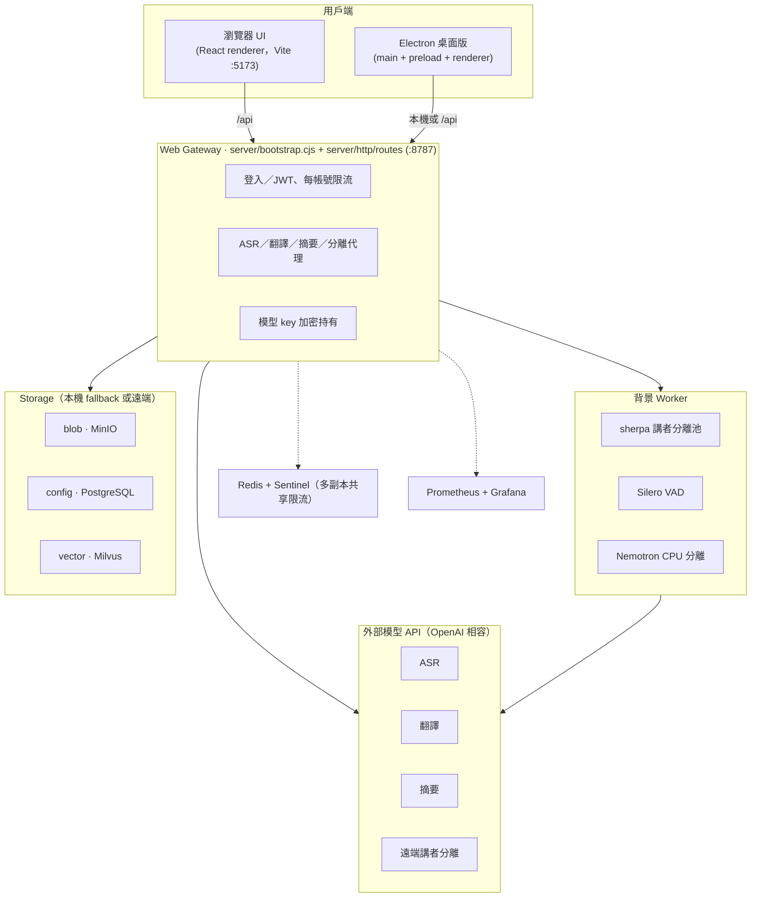

# 程式目錄與依賴責任

## 系統架構

- **模型 key 只由 gateway 或 Electron 主程序持有**，不進瀏覽器；renderer 只拿到可公開的顯示資訊。
- Web 版經 gateway 代理呼叫外部模型；Electron 可走 gateway 或本機 worker（如 `s2t-local://diarization`）。
- Storage 三種介面（`blob`／`config`／`vector`）各可獨立選擇本機 fallback 或對應遠端服務。

## 中立契約

`src/shared/contracts/` 是 application、models、settings、sessions、transcript、capture、response-speed 與 DesktopBridge 的單一型別來源；不依賴 renderer／server 實作。`src/shared/validation/` 提供 main、renderer、server 共用的 CJS runtime validator，Docker runtime 會包含該目錄。

## Renderer

| 位置 | 責任 |
| --- | --- |
| features/app | 路由與功能組裝。Controller 還有待抽離的 capture／sync／summary orchestration，不可再回填新領域服務。 |
| features/sessions | 三方合併、storage state、recovery domain 與 injected recovery handlers、remote repository。 |
| features/capture | VAD、resampling、AudioWorklet 與音訊輸出。 |
| features/models | ModelAdapter 契約、noop/WebSocket/HTTP adapters、ASR text domain。 |
| features/transcript | WAV/import、caption grouping、correction、逐字稿文件與畫面。 |
| features/translation | 翻譯策略與 revision/cancel-aware queue。 |
| features/summary | 摘要 templates/plan、stream decoder、document export 與 SummaryWorkspace。 |
| features/settings | 環境設定與 glossary domain、settings/admin/template 畫面。 |
| features/speakers | 講者結果解析、聲紋 storage、講者標註畫面。 |
| features/captions | 字幕呈現、paint metric、浮動視窗。 |
| shared/http | authenticated transport；不反向依賴 auth feature。 |
| shared/events、shared/ui | 組合用 EventChannel 與無 domain 依賴的共用 UI。 |

`shared/types.ts`、`model-adapter.ts` 與 `src/shared/response-speed.ts` 是相容 exports，沒有原本的 domain／adapter 實作。功能測試直接 import 正式 service；不要擷取 controller 宣告字串作為長期測試介面。

## Server

| 位置 | 責任 |
| --- | --- |
| server/index.cjs | CLI 啟動、process signals 與 exit；匯入不啟動服務。 |
| server/bootstrap.cjs | 明確 startGateway() 組裝、readiness、可等待 stop；其餘 routes/services 仍待拆分。 |
| server/http/app.cjs、http/routes | 無 listen 副作用的 createHttpApp；recordings、sessions routes 已拆分。 |
| server/jobs/diarization.cjs | 注入依賴的單筆 durable job runner；排程由 bootstrap 擁有。 |
| server/auth | 登入與撤銷、bootstrap、user stores；sharing authorization 與展示用 Department 分離。 |
| server/storage | local、MinIO/PostgreSQL/Milvus adapters，CAS／update 與 job fencing。 |
| server/audio/wav.cjs | 不依賴模型的 WAV decoding/resampling，解除 Silero/Sherpa 循環。 |
| server/audio/clients | 明確 local/remote AudioOperations；不散播 worker pool 內部介面。 |
| server/http/internal-audio.cjs | private audio HTTP surface 與 import proxy。 |

每組 remote storage 環境變數必須完整；完全沒有設定時才使用該本機 adapter。Credentials 不經 renderer 傳送或回傳。Kubernetes 的 shared storage／lease fencing／drain 契約不可因搬檔改變。

## 檢查入口

`npm run check:architecture` 檢查執行期 SCC、shared → feature 與 src → server 的反向引用。`npm run check` 執行 typecheck、architecture gate、安全本機／HTTP tests，以及 Electron/Web build。模型、瀏覽器與外部 storage tests 明確分組，見 tests/README.md。
