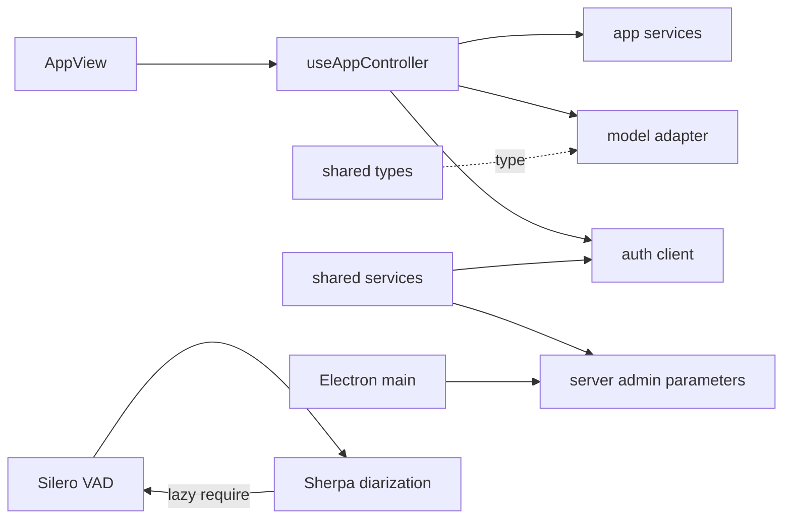

# Code graph 分析

> 歷史／研究文件：以下數據、路徑與命令僅代表記錄版本，不是現行操作入口。最新操作與驗收請以 [文件入口](../README.md)、[目前結果](VALIDATION_2026-10-26.zh-TW.md) 及 [重現指南](../guide/REPRODUCE.zh-TW.md) 為準。

以 TypeScript compiler AST 建立 `src/`、`server/` 的模組依賴圖，涵蓋 import、export-from、字串 require 與動態 import。環境未找到名稱為 code-graph 的工具或 plugin，本報告使用本機靜態分析，並非宣稱已使用該第三方產品。

重跑：`node scripts/analysis/code-graph.cjs`。原始節點、依賴、來源行號與指標在 `CODE_GRAPH_2026-10-13.json`。本次 100 個模組、226 條本地依賴；邊數保留重複引用，fan-in/out 按不同模組去重。排除 declaration files、外部套件、測試、部署與實驗腳本。

## 熱點

| 模組 | 依賴其他模組數 | 被依賴模組數 | 行數 |
| --- | ---: | ---: | ---: |
| useAppController.ts | 33 | 3 | 3486 |
| AppView.tsx | 25 | 1 | 644 |
| server/index.cjs | 20 | 0 | 1547 |
| model-adapter.ts | 5 | 11 | 716 |
| shared/i18n/index.ts | 5 | 25 | 468 |
| shared/types.ts | 2 | 15 | 151 |
| auth-client.ts | 1 | 12 | 65 |

controller 有 136 處 `window.s2t` property access，240 個 useState/useRef/useEffect/useCallback/useMemo 呼叫；包含巢狀 callback 中的字面呼叫，指標不代表同時執行次數或合法 hook 個數。它是平台與功能交會的主要節點。main/index.ts 雖然只有兩個本地模組依賴，仍約 727 行：低 fan-out 不代表內聚良好。

高 fan-in 的 i18n 是合理共用入口，不能單憑數值就拆。model-adapter 同時定義共用事件契約與模型執行邏輯，使純型別消費者也依賴具體 feature；優先分離 contracts，再拆 adapter 實作。

## 循環與分層

- **一組執行期依賴循環**：`server/silero-vad.cjs:5` 匯入 Sherpa 的 WAV helpers；`server/sherpa-diarization.cjs:343`、`:385` 在函式內 require Silero。作者已有 lazy-require 註解，不能由此推論目前啟動故障。建議把 `readWavSamples`、`resampleMono` 搬到中立 `server/audio/wav.cjs`，使 Silero 不再依賴完整 diarization 模組；保留目前 lazy 載入模型的行為與推論測試。
- **一組包含型別的 i18n 循環**：index 匯入五個 messages 模組；messages 以 `import type` 回引 UiLanguage。runtime 圖不包含此循環。可將 UiLanguage 放 `i18n/types.ts`，優先級低。
- **四條 src → server 引用**：main/index、AdminSettingsPanel、shared/services/settings 引用 admin-parameters，settings 有多個 import declaration。建議中立 validator/contracts 搬到 `src/shared`，或建立 server 與 src 都能引用的 contracts 目錄；不要把 server bootstrap 帶進 renderer。
- **五條 shared → feature 引用**：caption-metrics、remote-pcm-recording → auth-client；settings → capture/vad；transcript、shared/types → model-adapter（後兩者是 type-only）。auth transport 可放 shared/http，把 login/session UI 留在 auth feature；TranscriptEvent、ResponseSpeed、VadConfig 等契約置於中立層。
- 合計九條分層候選違規是針對建議架構規則，不代表 repo 原本有明訂禁止規則，也不代表九個功能 bug。

## 修改計劃調整

1. 先修前一份 review 的資料合併、聲紋 header 與 recovery harness；graph 不會證明這些行為正確。
2. 先抽 contracts、auth transport、WAV helpers，清掉反向依賴與 Silero/Sherpa 循環，作為搬動 features 的前置步驟。
3. 再抽 session sync/recovery、summary 與 settings；每次讓 controller 依賴一個明確入口，避免用 barrel exports 隱藏原本的耦合。
4. 拆 model-adapter.ts 的事件型別與具體 adapters；最後將 gateway 的 domain services、HTTP 與 bootstrap 分離。
5. CI 加入圖檢查：禁止新增 runtime SCC、shared → feature 與 src → server 引用；先列既有 baseline，逐步減少。當前分析腳本只產出報告，尚未實作 CI gate。

## 分析限制

此圖是模組依賴圖，沒有解析到跨檔函式呼叫、IPC channel、HTTP endpoint、Worker URL、React callback 與 runtime DI。AST 內的 calls/functions 是語法節點數，不是可靠 call graph 或 cyclomatic complexity。未解析到的 `./styles.css` 是非程式資產，並非缺檔。動態組合的 require/import 與 worker entry paths 可能漏列，不能以沒有入邊推論 dead code。

工作目錄原本有未提交變更，且審查時仍在變動；本次行數與前一份 report 略有差異。正式修正前應在固定 commit 或快照重新產圖並跑驗證。
