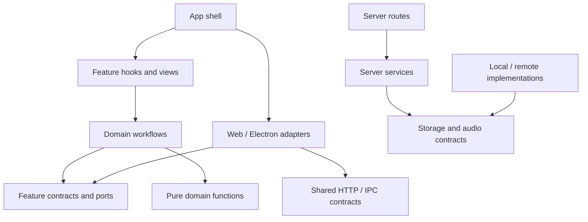

# 整合審查與修改計劃

> 歷史／研究文件：以下數據、路徑與命令僅代表記錄版本，不是現行操作入口。最新操作與驗收請以 [文件入口](../README.md)、[目前結果](VALIDATION_2026-10-26.zh-TW.md) 及 [重現指南](../guide/REPRODUCE.zh-TW.md) 為準。


日期：2026-10-13。這份文件整合 code review、code-review-graph、目錄責任與抽象設計檢查，是實作前的統一修改計劃。沒有套用產品重構，也沒有替使用者提交 Git commit／推送。

## 結論與設計決策

需要調整 code 位置，優先解除反向依賴、抽離工作流程與平台 I/O；只搬檔無法解決目前的同步與復原問題。

**目前沒有必須新增 abstract class 的地方。** 已存在 `ModelAdapter` interface 與三個實作，應保留；需要新增的是小型 ports/interfaces、注入依賴，以及一個共用事件分派元件。WebSocket 與 HTTP chunked ASR 的 start/stop、queue、timeout 語意不同，不適合繼承同一個具體生命週期。只有將來證實實作與生命週期相同，才考慮窄範圍 abstract base。

已有 `recoverSession(entry, handlers, progress)` 的純協調函式，不能把它描述成尚未存在；真正未抽離的是 controller 裡各 recovery handlers、audio/model I/O 與狀態接線。`BufferedPcmWriter` 已以 append callback 組合後端，也應沿用，不再建立 BaseRecording 類別。

## 本次再檢查的證據

- 重新讀取 ModelAdapter、三個 adapter、OPFS／remote PCM／buffered writer、recovery orchestrator／handlers、主程序 IPC、auth、audio-client factory、local/remote storage 與建置配置。
- 再次以 code-review-graph 2.3.5 建圖，使用程序內 `.cjs → JavaScript` 映射，納入未追蹤 src/server/tests/scripts/deploy 程式。查詢與圖產物見 [工具分析](CODE_REVIEW_GRAPH_2026-10-13.zh-TW.md)、[JSON](CODE_REVIEW_GRAPH_2026-10-13.json)。其測試辨識與 impact radius 有已記錄限制。
- `npm run typecheck` 本次通過；recovery handlers 測試仍以 `ReferenceError: liveCorrectionRunnerRef is not defined` 失敗。
- 對正式 `OpfsPcmRecording.recover` 注入檔案系統 mock，確認取回 48-byte WAV 時來源已被 remove；模擬後續遠端保存失敗，來源已不存在。這是方法層故障重現，不是完整瀏覽器 E2E。
- 工作目錄有使用者原先的未提交修改，以及大量既有文件／實驗檔案刪除；本次未復原、stage 或合併這些變更。歷史圖檔、行數與連結須以固定 snapshot 作實作前 baseline。

## 功能缺陷與重構的先後

| 項目 | 優先級 | 現況／證據 | 修正與驗收 |
| --- | --- | --- | --- |
| Session 衝突合併 | P1 | 直接執行 mergeSessions 重現刪除復活與遠端標題被舊值蓋掉 | baseline/local/remote 三方合併＋明確刪除意圖；同筆衝突可見，兩視窗交錯增刪改不丟資料 |
| OPFS 提前清除 | P1 | recover 內先 remove；controller 才 saveAudio，失敗被 catch；stopCapture 保存失敗後也走 discard | recovery 讀取不消耗來源；audio 與 session metadata 都有 durable ACK 才清除；保存中斷／重啟仍可重試 |
| 聲紋 consent header | P1 | gateway 查錯整串逗號 header 名稱 | 正確 key＋讀 body 前驗 scope/consent；補 positive enrollment case |
| 部門授權來源 | P1，限共享部署 | register 自行填 Department，共享可見性使用該值 | 可信群組／核准狀態與展示欄位分離；先阻擋未核准參與共享，再啟用共享成功路徑 |
| Logout revoke | P2 | revoke catch 包含 storage write failure | 無效 token 與持久化故障分別處理；有效 token 撤銷失敗不能回成功 |
| 正式 bootstrap | P2 | 未填變數仍 admin/admin | 開發明確 opt-in；首次正式初始化缺明確憑證時 readiness 失敗；已有 admin 保持可啟動 |
| Recovery harness | P2 | source slice/new Function 與 mock 脫節，實際失敗 | handler/service 正式 export 後直接 import；以 fault injection 驗證成功步驟保留與局部重試 |

OPFS 清除必須同時涵蓋啟動復原與停止錄音兩条路徑。遠端 chunk promote 的冪等與補償機制也應保留；不能只在單個 catch 裡不刪檔，卻遺失 recovery manifest 或把來源 ID 清空。詳細早期 findings 見 [原始 review](CODE_REVIEW_2026-10-13.zh-TW.md)。

## 每個模組的搬動／抽取決策

表中路徑相對於 repo；`renderer/` 簡寫為 `src/renderer/src/`。

| 現有來源 | 目標位置 | 動作與邊界 |
| --- | --- | --- |
| renderer/features/app/hooks/useAppController.ts | 原位保留薄組裝；各領域 hook/service 移到對應 feature | 不直接把 3,400 行搬進 BaseController；逐步移出 workflow、I/O、refs 所有權 |
| app/services/session-merge、session-recovery、remote-session-storage、session-storage-state | features/sessions/{domain,services,hooks}/ | merge/recovery 純函式在 domain；sync coordinator/handlers 在 services；React subscription 在 hooks |
| controller 的 history/search/page/edit/delete/continue | features/sessions/{hooks,views}/ | history view model 與操作；音訊續錄由 capture workflow 接受明確 session context |
| app/services/summary-*、SummaryWorkspace、MarkdownSummary | features/summary/{domain,services,hooks,views}/ | template、plan、stream decode、generation/translation；模板設定 editor 在 settings，讀 template repository |
| app/services/translation-queue、translation-policy | features/translation/{domain,services}/ | 保留 queue cancellation/revision fencing；caption grouping 契約置於 transcript 領域，避免 translation → app |
| app/services/live-caption、quality-correction、transcript-documents | features/transcript/{domain,services}/ | 已有 WAV/import feature 延伸，不另外建立重疊的 live-transcript feature；models 產事件，transcript 管文字規則 |
| app/views/settings/*、environment-settings、model registry 編輯邏輯 | features/settings/；模型編輯在 features/models/ | settings 負責組裝與保存；models 負責 profile/schema/health；summary template editor 可由 settings 組裝 |
| app/views/SpeakerBatchRename 等講者專用畫面 | features/speakers/views/ | 講者辨識與標註 UI；通用 tooltip/button 才放 shared/ui |
| app/views/CaptionPopout、caption-popout service | features/captions/ | 字幕呈現與浮動視窗，使用 transcript domain；platform bridge 留外部 adapters |
| app/views/AppView.tsx | 保留 app shell，抽 feature views | view 接受專屬 props；停止全量 AppController 傳遞與 raw setter 洩漏 |
| models/model-adapter.ts | models/contracts.ts、adapters/{noop,websocket,openai-chunked}.ts、domain/asr-text.ts | ModelAdapter 留在 models 契約；TranscriptEvent 移 transcript domain；純 sanitizer 獨立；HTTP adapter 注入 transport |
| shared/types.ts | 按 sessions/settings/transcript domain 拆分，過渡 re-export | 不一次打碎所有 import；資料契約只能依賴中立契約／其他 domain 契約，不依賴 adapter 實作 |
| shared/services/auth transport callers | shared/http/authenticated-client.ts；auth service 留 feature | authenticated transport 注入 session access；login/logout UI 與狀態留 auth；shared 不反向依賴 auth feature |
| server/admin-parameters.cjs、d.cts | src/shared/validation/admin-parameters.cjs、d.cts | 保留 CJS 相容，更新 main/renderer/server imports；Docker runtime 加入該檔案 COPY |
| response-speed.ts 與 capture/vad 中相關型別 | src/shared/contracts/response-speed.ts；capture/contracts.ts | 保留現有 normalize 單一來源；EnergyVad 實作留 capture；設定型別不匯入 capture 實作 |
| OPFS、remote PCM、BufferedPcmWriter | features/capture/recording/{ports,adapters,buffered-writer}/ | 錄音專用 infrastructure 由 capture 擁有；其他 feature 經 ports 消費，不在 shared 收納所有服務 |
| src/main/index.ts | main/ipc/{gateway,models,recordings,sessions,captions}.ts；main/services、main/storage | bootstrap 建立依賴並註冊 handlers；帳號/路徑/role 驗證留 trusted main，每次 IPC 驗證 |
| preload/index.ts、index.d.ts | preload bridge 保持；src/shared/contracts/desktop.ts | 主程序、preload、renderer 共用 DTO；unknown IPC 入參仍 runtime validate，不能只依赖 TS |
| server/index.cjs | server/bootstrap.cjs、http/{app,routes,middleware}、services/、jobs/ | 現有 index 保留啟動 wrapper；createHttpApp(deps) import 不 listen；process roles 明確組裝 |
| server/audio-service.cjs | audio/clients/{local,remote}.cjs 與 http/internal-audio.cjs | client 與內部 handler 分離；factory 只暴露允許操作，不 `{...local}` 洩漏整包介面 |
| sherpa WAV helpers、silero-vad | server/audio/wav.cjs；audio 各模型模組 | WAV/resample 共用純函式，解除 lazy require 循環，保留模型 lazy loading |
| server/storage/{local,remote,index}.cjs | 第一階段原位保留，補契約 | 後續如有需要按 backend 拆；先驗證 CAS/update/lease 語意，不為一致目錄立即搬遷 |
| styles.css | 後期 shared/styles + feature styles | 先拆 view，再按實際使用搬 CSS；避免盲目全域 selector 修改 |
| scripts/deploy/experiment | 延用現有分類，新增責任／資產 manifest | 正式操作、可重跑實驗、歷史證據明確標記；已有刪除需另審，不把清理算重構 |

## Interfaces、classes、函式的具體選擇

| 邊界 | 決定 | 原因／實作約束 |
| --- | --- | --- |
| ModelAdapter | 保留 interface 與三個 class；加入明確 capabilities | flush/updateLiveSettings 現在 optional；保留相容入口，再由 capabilities 做產品可用性決策，不用空實作假裝支援 |
| 重複 transcript/error listeners | 抽 composition 型 EventChannel<T>，不抽 BaseModelAdapter | 三個 adapter 重複訂閱/退訂；共享這部分足夠，start/stop 與 queue 留各實作 |
| Chunk ASR transport | AsrTransport interface | Electron IPC／Web gateway 實作，adapter 不再查 window.s2t；signal、timeout、錯誤分類與 diagnostics 在契約明確化 |
| Translation／summary transport | 分別 TextCompletionPort、SummaryStreamPort | batch 與 stream 的輸出與取消不同；不把所有模型操作塞進一個万能 ModelService |
| PCM 寫入 | PcmSink interface：append、finish、abort；BufferedPcmWriter 組合 sink | finish 回 typed artifact，不要求每端回 Blob；factory 按能力建立 adapter |
| 可復原錄音 | RecordingRecoveryStore：inspect/read/acknowledge | read 不刪，ack 才清除；promote/remote cleanup 另外提供 remote commit capability |
| Session 保存 | LocalSessionRepository、RemoteSessionRepository 分開 | Electron 本機沒有遠端 version；Web 有 CAS，不把 version 加到所有 repository 或用 0 當假版本 |
| Session 同步 | SyncCoordinator 普通 class 或 closure factory，持有狀態 | 需要 pending snapshot、baseline、delete intents、retry clock、epoch；不需繼承；React hook 訂閱結果 |
| Recovery／summary 工作流程 | 函式＋注入 handlers/ports | 沿用 recoverSession；不依賴 React setter，progress 為 typed domain event |
| Server blob/config/vector | JSDoc typedef/契約與 contract tests | 保留具體 classes，無需 abstract base；ConfigStore 與 JobStore 分能力，不能把 postgres-only 能力假裝 local 都有 |
| 音訊 internal client | AudioOperations port＋明確 local/remote factory | 避免 client 混入 worker pool 管理／本機診斷；保持 HTTP codec/limits/timeout 契約 |
| merge、policy、WAV、validators | 純函式 | 沒有 state/lifecycle，不應為面向物件而建立 class |
| React hooks/views | hook/函式 component | 依領域組合，不用繼承 Controller/View 基底 |

設計草案（不是已實作 API）：

```ts
type RecordingArtifact =
  | { kind: 'local'; recordingId: string; audioPath: string }
  | { kind: 'opfs'; recordingId: string; audio: Blob }
  | { kind: 'remote'; recordingId: string; persistedSamples: number }

interface PcmSink {
  append(pcm16Mono: ArrayBuffer): Promise<void>
  finish(): Promise<RecordingArtifact>
  abort(): Promise<void>
}

interface RecordingRecoveryStore {
  read(id: string): Promise<RecordingArtifact | undefined>
  acknowledge(id: string): Promise<void>
}
```

sample rate、owner、operation epoch 在建立 sink/recovery context 時固定。呼叫方不能拿 path/recordingId 繞過 main 或 server 的帳號驗證；artifact 僅內部使用，HTTP DTO 不公開 native path。finish 冪等／close failure／abort 是否保留可復原資料，需要在各 adapter contract test 明確驗收。

## 目標依賴方向



domain 不匯入 React／window.s2t／fetch／Electron；shared 不匯入 feature implementation。feature 之間只依賴契約或純 domain 函式；跨功能 orchestration 留 app 層。preload 是 capability bridge，不新增 domain logic。

## 實作批次、依賴與驗收

各批次切成可獨立 review 的小 PR；行為修復與純搬檔分開，不把多份使用者未提交變更一併納入。

| 批次 | 交付內容 | 前置依賴 | 完成條件 |
| --- | --- | --- | --- |
| A：固定 baseline | 檔案/hash/branch 快照、現有失敗清單、直接測試依賴、安全 test scripts；危險 integration opt-in | 無 | 乾淨 checkout 有可重跑的 test/build/typecheck；原有失敗明確標記，不冒稱全綠 |
| B1：錄音保全 | OPFS read/ack；metadata/audio commit 後 cleanup；可重試 manifest | A | 遠端 audio 失敗、metadata 失敗、reload、重複 ACK、清理失敗均保留必要來源；正常成功不積累來源 |
| B2：Session 衝突 | 三方合併、刪除意圖與同筆 conflict；結構化 HTTP error | A | 交錯新增/刪除/編輯、背景講者完成、save 回覆遺失重送；不靜默覆寫 |
| B3：共享／auth | consent、可信 Department、revoke、bootstrap，分開 PR | A | 同意／未同意、跨部門、未核准帳號、撤銷 write outage、已有 admin／新環境設定測試 |
| C：中立契約 | TranscriptEvent、ResponseSpeed/VAD、admin validator、IPC DTO、auth transport、WAV helpers | A | 清除指定反向 imports；CJS runtime path 和 Docker COPY 正確；SCC 不增加 |
| D：Session workflow | SyncCoordinator、recovery handlers、typed progress、useSessions | B1/B2、C | recovery test 直接 import handlers；停止字串 slice/eval；現有成功步驟與手工標註保留 |
| E：模型與錄音 adapters | 拆 ModelAdapter 實作、EventChannel、AsrTransport、PcmSink；capture workflow | C、D | pause/flush/stop/drain、queue overflow、取消、timeout、unmount 與 restart；每種 sink 共用測試＋能力專用測試 |
| F：功能目錄／畫面 | summary/translation/settings/models/speakers/captions views、feature hooks、小型 props | D、E；可按 feature 分批 | 原有可見流程與 i18n 不變；晚到回覆不能覆寫新操作；帳號切換不跨帳號發事件/寫入 |
| G：Server/main 組裝 | createHttpApp(deps)、routes/services/jobs、main IPC handlers、audio client | C、B3 | import 不 listen；readiness/drain、request limits、CAS、lease generation、補償與帳號路徑保護均驗證 |
| H：治理與收尾 | CSS、test 分類、docs links、腳本與資產 manifest、architecture gate | 各批完成 | 所有相對 imports／worker/worklet/static 路徑更新；部署與實驗入口可重跑；新增 runtime SCC/禁止反向依賴會使 CI 失敗 |

B1、B2、B3 可獨立 review，但任何共享功能上線必須同時滿足可信授權條件。沒有逐筆 revision API 的短期 B2，仍需可見同筆衝突；下一階段 per-session update/delete API 另立 schema/API migration PR。

## 需要保留的語意與風險控制

- 錄音持久化 ACK、PCM 背壓、remote chunk index/start sample、OPFS recovery retention；不因抽介面改變 timeout 或 buffer limits。
- 翻譯 revision／取消與 source/target settings 快照；summary generation epoch；session processingToken、講者 job lease generation，避免晚到回覆。
- Web 遠端為紀錄來源、Electron 本機持久化；OPFS 是工作中／故障復原的暫存，不再引入另一份永久 history truth。
- Durable ACK 與 UI state 分離；pending/local/remote/both 的判斷不能以顯示字串或整筆 JSON equality 長期代替 commit revision。
- Storage adapters 的 compareAndSwap/update 原子性、job fencing、voiceprint/audio compensation；不能用共同基底類別掩蓋不同後端交易能力。
- 對 new async workflows 注入 clock/AbortSignal/account epoch；退出或帳號切換需要 release resources 和隔離 late results。這是驗收要求，未在本次聲稱已重現跨帳號寫入漏洞。

每批先行為修復＋測試，再搬檔；重構批次保留相容 re-export／啟動 wrapper，驗證後才刪。需要資料遷移時先 additive migration 與舊欄位 fallback，再清理；不要把 Git history rewrite 或資產刪除當作回滾方式。

## 最終驗收與範圍限制

1. 固定 snapshot 跑 typecheck、Electron/Web build、本機非破壞性測試；Node 版本對齊 Docker 的 Node 22，目前檢查宿主是 Node 26。
2. 必要 browser/Electron 驗收涵蓋收音、匯入、暫停、停止、續錄、復原、取消、摘要、聲紋、刪除與帳號切換；不能只驗 service mocks。
3. 使用隔離 storage 環境驗 remote CAS、補償、role 分離、job fencing/drain；會刪資料／停容器的套件不接入預設 test。
4. 重新產模組圖與 code-review-graph：反向依賴和 runtime SCC 有具體減少；不以總邊數或 controller 行數當作唯一完成指標。
5. 每個 feature 有自己的可測 service/view contract，AppController 不再將整包 refs/setters 暴露給全部畫面。

這份計劃已檢查實際程式與圖資料；未執行完整 build、所有 E2E 或真實 storage/model/Kubernetes。本次新確認的 OPFS 來源清除風險與前次 findings 的驗證強度均有標明。工時應在 baseline 與第一批小 PR 後估算，不以函式行数直接給總天數。
